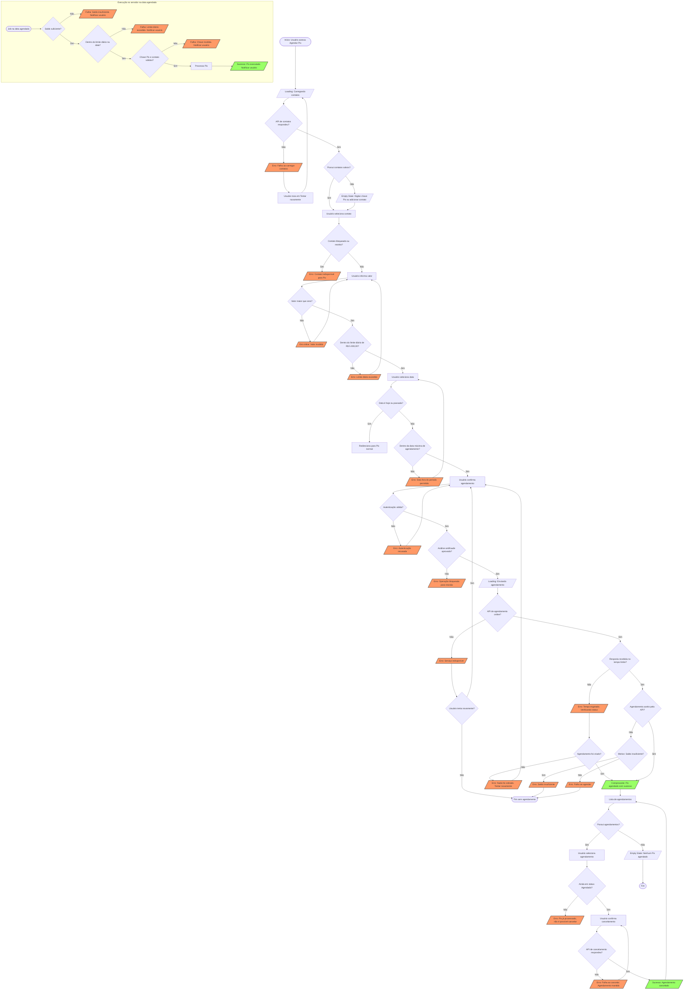

# Análise de Requisito: Pix Agendado

## analise_de_risco

**1. Limite diário sem definição de contagem.** O ticket não diz se o limite de R$ 5.000,00 é consumido no momento do agendamento ou na data de execução. Essa diferença muda o comportamento do sistema quando o usuário agenda vários Pix para dias diferentes, ou cancela um agendamento.

**2. Saldo não garantido na execução.** Nada define o que acontece se o saldo for insuficiente na data agendada. Sem essa regra, o Pix pode falhar silenciosamente, o que gera reclamações e risco regulatório.

**3. Janela de cancelamento não definida.** O ticket pede um botão de cancelar, mas não diz até quando. Não há regra para agendamentos já processados, em processamento ou em andamento.

**4. Ambiguidade de "mesmo dia" e fuso horário.** Não está claro o que acontece se o usuário agendar às 23h55 para "amanhã", ou se existe horário de corte. Como o usuário está em America/Sao_Paulo, o corte precisa ser definido nesse fuso.

**5. Contato ou chave alterados ou excluídos.** Se o contato for removido, bloqueado ou tiver a chave Pix alterada entre o agendamento e a execução, não há regra de tratamento.

**6. Autenticação da operação.** Pix é movimentação financeira. O ticket não menciona confirmação por senha, token, biometria ou verificação antifraude no momento do agendamento.

**7. Escopo do "contato".** Não fica claro se o contato pode ser uma chave Pix digitada livremente, apenas um contato salvo, ou ambos.

## mapeamento_de_estados

| Tela / Componente | Estado | Comportamento esperado |
|---|---|---|
| Seleção de contato | **Loading** | Skeleton na lista de contatos enquanto carrega |
| Seleção de contato | **Vazio** | Nenhum contato salvo: oferecer "Digitar chave Pix" ou "Adicionar contato" |
| Seleção de contato | **Erro** | Falha ao carregar contatos: mensagem com botão "Tentar novamente" |
| Campo de valor | **Validação** | Valor zero, negativo ou acima do saldo/limite restante: erro inline, botão de confirmar desabilitado |
| Campo de valor | **Limite parcial** | Mostrar "Você ainda pode agendar R$ X hoje" ao usuário |
| Seleção de data | **Inválida** | Data de hoje ou passada desabilitada no calendário, com explicação de que hoje é Pix normal |
| Seleção de data | **Limite de data** | Definir data máxima de agendamento (ex.: 30 ou 365 dias) e exibir no seletor |
| Confirmação | **Loading** | Botão em loading e bloqueio de duplo clique para evitar agendamento duplicado |
| Confirmação | **Erro de saldo** | Mensagem específica de saldo insuficiente |
| Confirmação | **Erro de limite** | Mensagem específica de limite diário excedido |
| Confirmação | **Erro genérico / timeout** | Mensagem de falha sem cobrança; permitir nova tentativa sem duplicar agendamento |
| Comprovante | **Sucesso** | Dados do agendamento: contato, valor, data, identificador e status "Agendado" |
| Comprovante | **Falha** | Não exibir comprovante de sucesso; mostrar motivo e ação |
| Lista de agendamentos | **Vazio** | "Você não tem Pix agendados" com CTA para agendar |
| Lista de agendamentos | **Loading / Erro** | Skeleton e mensagem de erro com retry |
| Cancelamento | **Confirmação** | Modal pedindo confirmação antes de cancelar |
| Cancelamento | **Não cancelável** | Botão desabilitado ou oculto com explicação quando o Pix já está em processamento ou executado |
| Cancelamento | **Sucesso / Erro** | Atualizar status na lista; em caso de erro, manter o agendamento e informar |

## cenarios_ocultos

1. **Agendamento para o dia seguinte após o horário de corte.** Definir se o sistema aceita e para qual data é executado.
2. **Saldo que muda entre agendamento e execução.** O usuário agenda com saldo suficiente, gasta o saldo, e na data o Pix falha. Precisa de notificação ao usuário.
3. **Múltiplos agendamentos no mesmo dia.** Dois Pix de R$ 3.000 agendados para a mesma data ultrapassam o limite. Decidir se o segundo é recusado no agendamento ou na execução.
4. **Cancelamento após a execução.** O botão deve sumir ou desabilitar, e a tela deve explicar que o Pix já foi processado.
5. **Usuário sem sessão ativa no horário de execução.** A execução deve ocorrer no servidor, sem depender do app aberto.
6. **Contato bloqueado ou com restrição de segurança.** Verificar antes de agendar e antes de executar.
7. **Usuário tenta agendar para o próprio CPF/conta.** Definir se é permitido.
8. **Recuperação de falha na tela de confirmação.** O usuário fecha o app após clicar em confirmar. Ao reabrir, deve ver o agendamento criado ou o erro, sem duplicar.
9. **Mudança de fuso ou horário de verão.** Embora o Brasil não adote horário de verão atualmente, a regra deve usar o fuso de São Paulo de forma explícita.
10. **Acessibilidade.** O seletor de data e o botão de cancelar precisam de rótulos para leitores de tela.

## regras_de_negocio_conflitantes

1. **Limite diário vs. agendamento futuro.** Se o limite é diário e o agendamento é para outra data, não está claro qual "dia" conta. Risco de o usuário ficar bloqueado ou de exceder o limite real.

2. **"Se for hoje, é Pix normal" vs. horário de corte.** Um agendamento feito às 23h para "amanhã" pode ser tratado como hoje pelo sistema, dependendo do fuso e do horário de processamento. Precisa de regra explícita.

3. **Confirmação com sucesso vs. execução futura.** O ticket diz "se der sucesso, mostra o comprovante", mas o Pix ainda não foi executado. O comprovante deve indicar que é um agendamento, não uma transferência concluída. Caso contrário, o usuário pode interpretar que o dinheiro já saiu.

4. **Cancelamento sem prazo.** A regra "tem que ter um botão para cancelar depois" não define se o cancelamento é permitido após a data de execução. Isso pode gerar disputa com o cliente.

5. **Segurança ausente.** O ticket não exige autenticação forte para uma operação de pagamento. Recomenda-se alinhar com as regras de autenticação já usadas no app para transferências, e com as regras de Pix da instituição e do Banco Central, incluindo limites por tipo de transação e mecanismos antifraude.

## Perguntas para o PO antes do desenvolvimento

- O limite de R$ 5.000,00 é consumido no agendamento ou na execução?
- Qual é o horário de corte para agendamento e o prazo máximo de agendamento?
- Até quando o usuário pode cancelar?
- O que acontece com saldo insuficiente na data de execução? Há tentativa de reprocessamento?
- Qual autenticação é exigida na confirmação?
- O agendamento aceita chave Pix digitada ou só contatos salvos?
- O comprovante de agendamento tem layout diferente do comprovante de Pix concluído?

